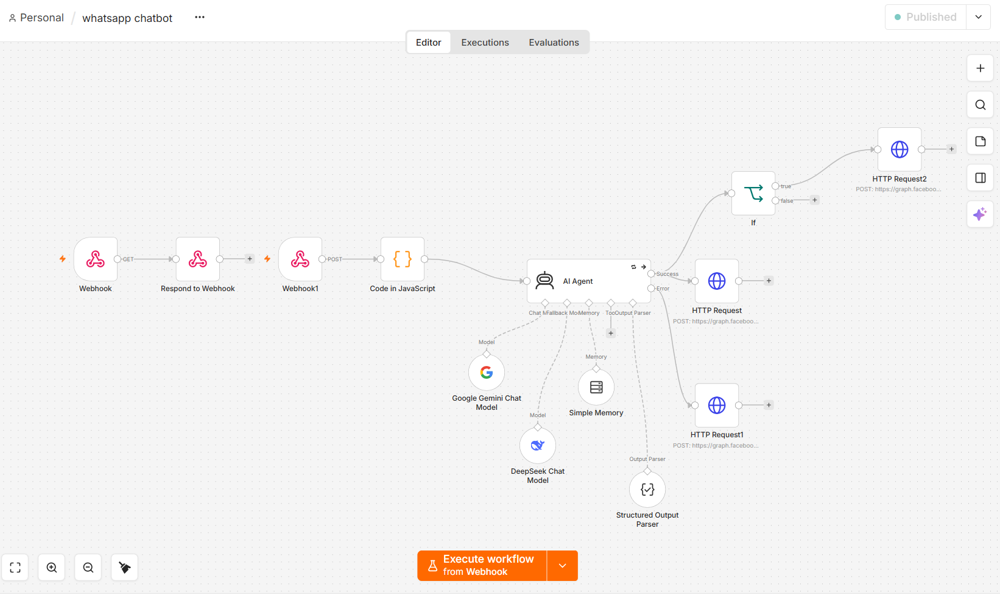
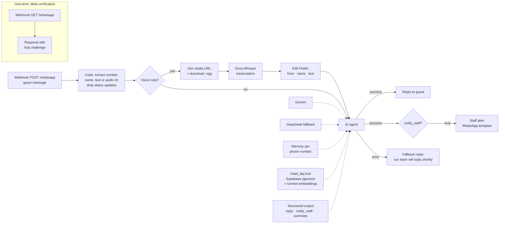
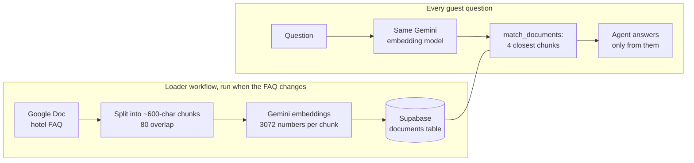
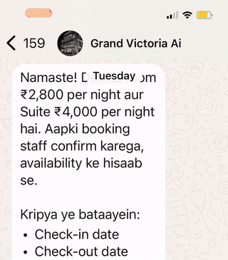
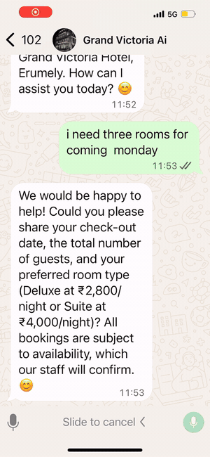
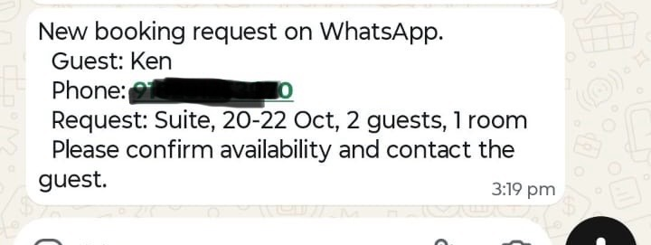

# AI WhatsApp concierge

Answers guest questions on the hotel's WhatsApp number, by text or voice note, in the guest's own language, and passes booking requests to staff. Answers come from the hotel's own FAQ through a RAG knowledge base, so the bot doesn't invent facilities or prices. Currently in pilot.

## Flow

### RAG knowledge base

**Demo on WhatsApp (sped up 3x):** a guest asks about check-in, asks for the suite price in Malayalam, then requests a suite for 20–22 October.

**Voice notes in French (sped up 4x):** the guest sends voice notes; they are downloaded from WhatsApp, transcribed with Groq Whisper, and answered in French. The request (1 Deluxe room, 5–7 November, 2 guests) is passed to staff.

**The staff alert, as received on the staff phone:**

## How it works

- **Webhook verification.** Meta checks the URL once with a GET request carrying `hub.challenge`; a separate GET webhook echoes it back. Guest messages then arrive as POST requests on the same path.
- **Filtering.** Meta also sends delivery and read receipts to the webhook. The Code node keeps only text and voice messages and returns an empty result for everything else, which ends the run quietly.
- **The AI agent** follows the rules in its system message: answer only from the FAQ tool, share rates but never confirm availability, and hand complaints and anything it doesn't know to staff.
- **Memory**, keyed by the guest's phone number, keeps the last 10 messages, so a guest can give their dates over several messages.
- **Structured output** makes the agent return three fields. `reply` goes to the guest; `notify_staff` decides whether staff are alerted; `summary` is the one-line request staff receive.
- **Staff alerts** use an approved WhatsApp template, because the hotel is starting that conversation. Replies to guests are free text, allowed inside WhatsApp's 24-hour window after the guest writes.

## Reliability

- Retry on failure, then a fallback model if Gemini is overloaded.
- If both fail, the error output still sends the guest a polite holding message, so nobody is left without a reply.
- AI-written text is inserted with `JSON.stringify(...)`, so quotes or line breaks in a reply can't break the request body.

## Using this export

Import the JSON into n8n, then:
- connect Gemini, DeepSeek, Groq and Supabase credentials
- run `supabase-setup.sql` in your Supabase project (and make sure its Data API is enabled), then load your own FAQ into the `documents` table with a loader workflow (Google Docs → Supabase Vector Store insert, with the same `models/gemini-embedding-001` embeddings)
- set `YOUR_PHONE_NUMBER_ID`, `YOUR_WHATSAPP_TOKEN`, `YOUR_GROQ_API_KEY`, `YOUR_STAFF_NUMBER` and `YOUR_STAFF_PHONE` (better: move the tokens into n8n Header Auth credentials)
- create and get approval for a `staff_booking_alert` template with three parameters (guest name, phone, request)
- adapt the system message to your property
- register `https://<your-n8n-domain>/webhook/whatsapp` as the callback URL in your Meta app and subscribe to `messages`
